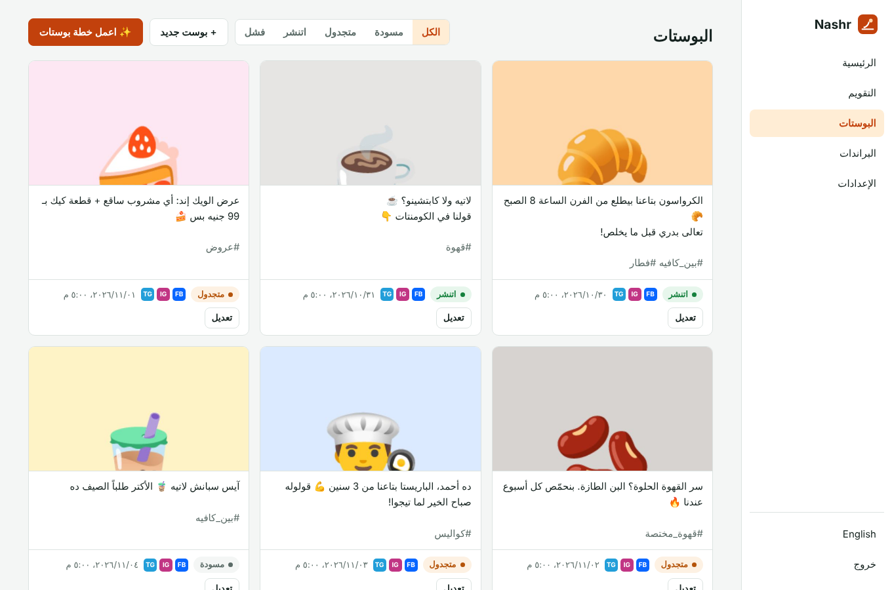
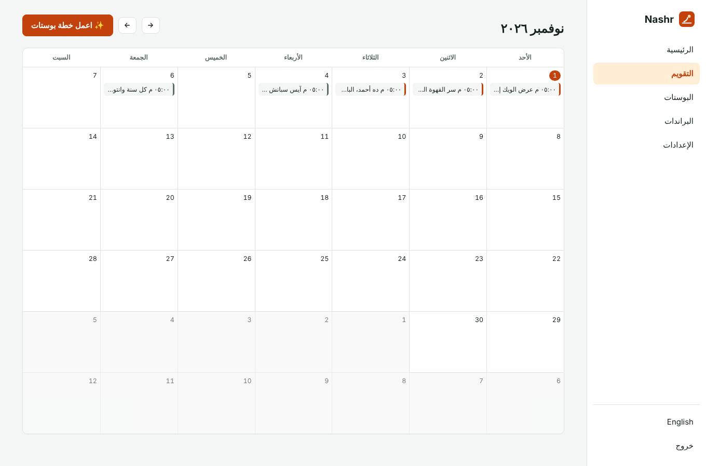
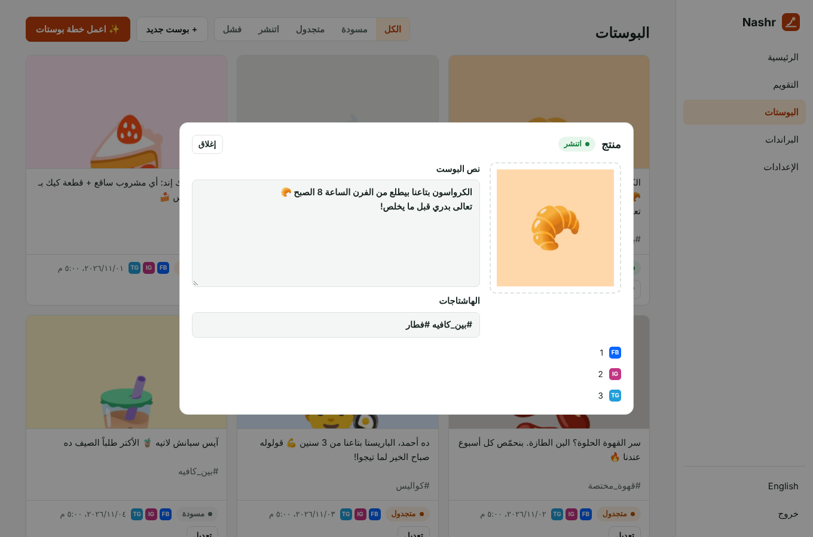

<div align="center">

# Nashr · نَشر

**Your social media, written and posted for you.**
Nashr is an open-source AI assistant that writes posts in your customers' dialect from your real products, plans your month, and publishes to Facebook, Instagram and Telegram on schedule. Self-hosted, no monthly fees.

[](https://www.hostinger.com/docker-hosting?compose_url=https://raw.githubusercontent.com/mashraf1997/nashr/main/docker-compose.yml&REFERRALCODE=YOUR_REFERRAL_CODE)

[English](#what-it-does) · [العربية](#بالعربي)



</div>

---

## What it does

- **Writes like a local business, not an ad agency.** Egyptian, Gulf or Levantine Arabic, simple standard Arabic, or English, in the tone you choose.
- **Plans a week or a month in one click.** Products, offers, tips, behind-the-scenes, questions that get comments, and occasions like Ramadan or Black Friday, mixed for you.
- **Uses your real products and prices.** Sync from **Dukkan**, **WooCommerce** or **Shopify** and every post about a product has the right name and price. No API keys needed.
- **You stay in control.** Every post starts as a draft. Edit it, ask for a rewrite ("shorter", "more excited", "focus on price"), add your photo, then approve. Or turn on auto-approve.
- **Publishes on time.** Facebook Pages, Instagram Business/Creator accounts and Telegram channels, at the days and times you set, in your time zone.
- **Safe retries.** If one platform fails, Nashr tells you why. A retry never double-posts to the platforms that already worked.
- **Built for agencies.** Run many brands from one install, each with its own voice, products, accounts and schedule.
- **Your model, your choice.** Claude from Anthropic (structured output, so plans never come back broken), or any OpenAI-compatible model such as Ollama on your own VPS.

<p align="center">
  
  
</p>

## Deploy

### One click on Hostinger

Click **Deploy on Hostinger** above, open `http://YOUR-SERVER-IP`, and create your password.

> **For Instagram:** Instagram downloads your photos from Nashr, so it needs a public **HTTPS** address. Point a domain at the server and turn on SSL first.

### Docker

```bash
git clone https://github.com/mashraf1997/nashr.git && cd nashr
docker compose up -d
```

### Node.js

```bash
npm install
npm start        # http://localhost:3000
```

Node.js 20 or newer.

## Connect your accounts

In **Brands**, open the brand and fill in:

| Platform | What you need |
|---|---|
| Facebook | Your Page ID and a long-lived Page access token with `pages_manage_posts` |
| Instagram | An Instagram Business or Creator account linked to the Page, its account ID, and a token with `instagram_basic` and `instagram_content_publish` |
| Telegram | A bot from [@BotFather](https://t.me/BotFather), added as an admin of your channel, and the channel name (`@mychannel`) |

Press **Send a test post** next to each one to check the connection.

## Configuration

| Variable | Default | Purpose |
|---|---|---|
| `PORT` | `3000` | HTTP port |
| `DATA_DIR` | `./data` | Where `nashr.json` and photos are kept. Back it up. |
| `SETUP_TOKEN` | *(empty)* | Required to create the first admin when set |
| `DEMO_MODE` | `false` | `true` makes this a public demo: sample data, a reset every hour, and settings that reach outside (tokens, keys, password) locked |
| `DEMO_PASSWORD` | `demo1234` | Password shown on the demo sign-in screen |
| `DEMO_RESET_MINUTES` | `60` | How often the demo data resets (minimum 5) |
| `DEMO_LANG` | `ar` | Language of the sample data: `ar` or `en` |
| `ANTHROPIC_API_KEY` | *(empty)* | Claude key, if none is entered in Settings |
| `AI_PROVIDER`, `AI_MODEL`, `AI_BASE_URL`, `AI_API_KEY` | | First-boot AI defaults |
| `META_GRAPH_VERSION` | `v23.0` | Graph API version |

## Development

```bash
npm test     # runs against fake Claude, OpenAI, Meta, Telegram and Dukkan servers
```

```
src/planner.js   prompts, structured plan generation, posting slots in the brand's time zone
src/publish.js   Facebook, Instagram (container + publish) and Telegram
src/catalog.js   Dukkan, WooCommerce and Shopify product sync
src/app.js       dashboard API and the publishing scheduler
public/          dashboard (no build step)
```

## Works well with

- [**Dukkan**](https://github.com/mashraf1997/dukkan): your WhatsApp ordering store. Nashr posts its products.
- [**Wakeel**](https://github.com/mashraf1997/wakeel): the AI employee that answers the customers your posts bring in.
- [**Mawid**](https://github.com/mashraf1997/mawid): your booking page.

## License

MIT

---

<div dir="rtl">

## بالعربي

**نَشر** مساعد ذكاء اصطناعي مفتوح المصدر للسوشيال ميديا. بيكتب بوستات بلهجة عملاءك من منتجاتك الحقيقية، وبيعمل خطة للشهر، وبينشر على فيسبوك وإنستجرام وتليجرام في مواعيدها. بتشغّله على سيرفرك، من غير اشتراك شهري.

- **بيكتب زي البيزنس المحلي** مش زي الإعلانات: مصري، خليجي، شامي، فصحى مبسطة، أو إنجليزي.
- **خطة أسبوع أو شهر بضغطة:** منتجات، عروض، نصايح، كواليس، أسئلة بتجيب كومنتات، ومناسبات زي رمضان.
- **منتجاتك وأسعارك الحقيقية** من Dukkan أو WooCommerce أو Shopify.
- **إنت المتحكم:** كل بوست بيبدأ مسودة. تعدّله، أو تطلب إعادة كتابة، وتضيف صورتك، وبعدين توافق.
- **بينشر في الميعاد** على فيسبوك وإنستجرام وتليجرام.
- **مناسب للوكالات:** براندات كتير في نفس التطبيق، كل واحد بأسلوبه وحساباته.

### التشغيل

1. اضغط **Deploy on Hostinger**.
2. افتح رابط السيرفر واعمل كلمة سر.
3. من **الإعدادات** حط مفتاح Claude أو اختار Ollama.
4. من **البراندات** اكتب معلومات البيزنس ووصّل حساباتك.
5. اضغط **✨ اعمل خطة بوستات**.

</div>
